# Wallpapers

A numbered gallery of the wallpapers in this repository, ordered from lowest to highest.

Each image is labeled with its wallpaper number.

## Gallery

<table>
  <tr>
    <td align="center"><a href="./wall1.jpg"> <b>1</b></a></td>
    <td align="center"><a href="./wall2.jpg"> <b>2</b></a></td>
    <td align="center"><a href="./wall3.jpg"> <b>3</b></a></td>
    <td align="center"><a href="./wall4.jpg"> <b>4</b></a></td>
  </tr>
  <tr>
    <td align="center"><a href="./wall5.png"> <b>5</b></a></td>
    <td align="center"><a href="./wall6.jpg">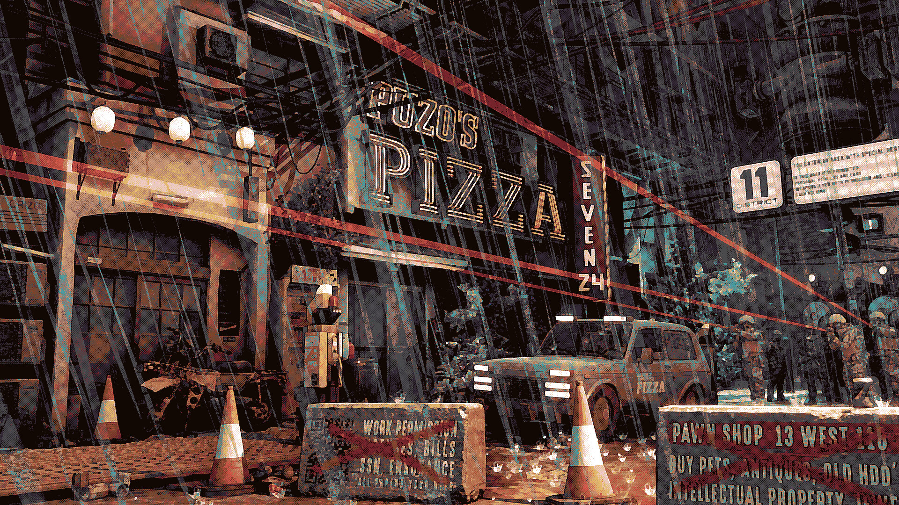 <b>6</b></a></td>
    <td align="center"><a href="./wall7.jpeg"> <b>7</b></a></td>
    <td align="center"><a href="./wall8.png"> <b>8</b></a></td>
  </tr>
  <tr>
    <td align="center"><a href="./wall9.png">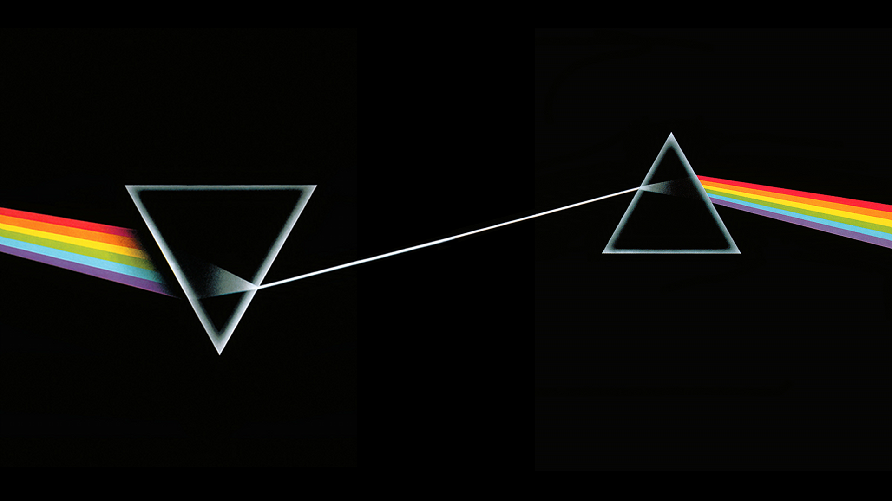 <b>9</b></a></td>
    <td align="center"><a href="./wall10.png"> <b>10</b></a></td>
    <td align="center"><a href="./wall11.png"> <b>11</b></a></td>
    <td align="center"><a href="./wall12.jpeg"> <b>12</b></a></td>
  </tr>
  <tr>
    <td align="center"><a href="./wall13.png"> <b>13</b></a></td>
    <td align="center"><a href="./wall14.jpeg"> <b>14</b></a></td>
    <td align="center"><a href="./wall15.png"> <b>15</b></a></td>
    <td align="center"><a href="./wall16.jpeg"> <b>16</b></a></td>
  </tr>
  <tr>
    <td align="center"><a href="./wall17.png"> <b>17</b></a></td>
    <td align="center"><a href="./wall18.jpeg">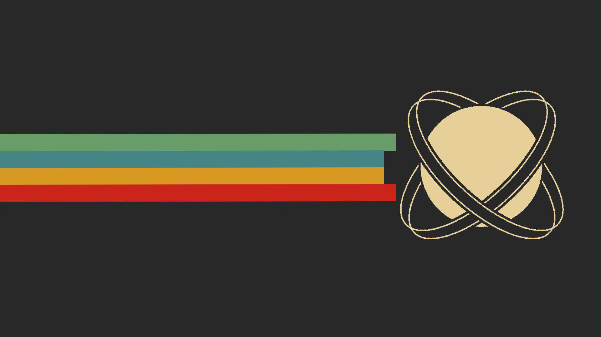 <b>18</b></a></td>
    <td align="center"><a href="./wall19.jpeg"> <b>19</b></a></td>
    <td align="center"><a href="./wall20.png"> <b>20</b></a></td>
  </tr>
  <tr>
    <td align="center"><a href="./wall21.png">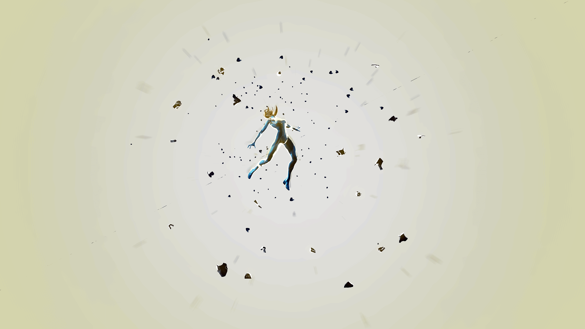 <b>21</b></a></td>
    <td align="center"><a href="./wall22.png">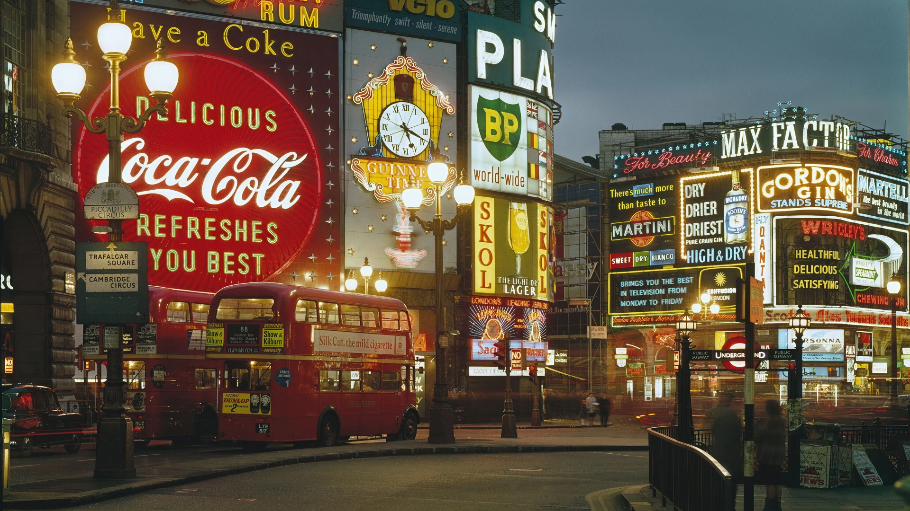 <b>22</b></a></td>
    <td align="center"><a href="./wall23.png"> <b>23</b></a></td>
    <td align="center"><a href="./wall24.png"> <b>24</b></a></td>
  </tr>
  <tr>
    <td align="center"><a href="./wall25.png"> <b>25</b></a></td>
    <td align="center"><a href="./wall26.png"> <b>26</b></a></td>
    <td align="center"><a href="./wall27.png"> <b>27</b></a></td>
    <td align="center"><a href="./wall28.png"> <b>28</b></a></td>
  </tr>
  <tr>
    <td align="center"><a href="./wall29.png"> <b>29</b></a></td>
    <td align="center"><a href="./wall30.png"> <b>30</b></a></td>
    <td align="center"><a href="./wall31.png"> <b>31</b></a></td>
    <td align="center"><a href="./wall32.png"> <b>32</b></a></td>
  </tr>
  <tr>
    <td align="center"><a href="./wall33.png"> <b>33</b></a></td>
    <td align="center"><a href="./wall34.png"> <b>34</b></a></td>
    <td align="center"><a href="./wall35.png"> <b>35</b></a></td>
    <td align="center"><a href="./wall36.png"> <b>36</b></a></td>
  </tr>
  <tr>
    <td align="center"><a href="./wall37.png"> <b>37</b></a></td>
    <td align="center"><a href="./wall38.png"> <b>38</b></a></td>
    <td align="center"><a href="./wall39.png"> <b>39</b></a></td>
    <td align="center"><a href="./wall40.png"> <b>40</b></a></td>
  </tr>
  <tr>
    <td align="center"><a href="./wall41.png">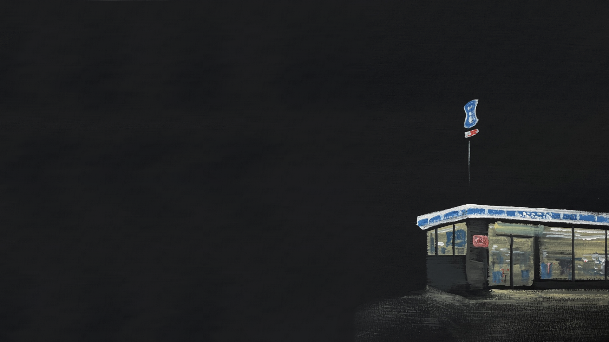 <b>41</b></a></td>
    <td align="center"><a href="./wall42.png"> <b>42</b></a></td>
    <td align="center"><a href="./wall43.png"> <b>43</b></a></td>
    <td align="center"><a href="./wall44.png"> <b>44</b></a></td>
  </tr>
  <tr>
    <td align="center"><a href="./wall45.png"> <b>45</b></a></td>
    <td align="center"><a href="./wall46.png"> <b>46</b></a></td>
    <td align="center"><a href="./wall47.jpeg"> <b>47</b></a></td>
    <td align="center"><a href="./wall48.png"> <b>48</b></a></td>
  </tr>
  <tr>
    <td align="center"><a href="./wall49.png"> <b>49</b></a></td>
    <td align="center"><a href="./wall50.png"> <b>50</b></a></td>
    <td align="center"><a href="./wall51.png"> <b>51</b></a></td>
    <td align="center"><a href="./wall52.png"> <b>52</b></a></td>
  </tr>
  <tr>
    <td align="center"><a href="./wall53.png"> <b>53</b></a></td>
    <td align="center"><a href="./wall54.png">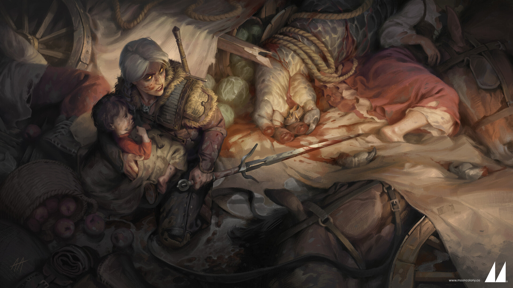 <b>54</b></a></td>
    <td align="center"><a href="./wall55.png"> <b>55</b></a></td>
    <td align="center"><a href="./wall56.png"> <b>56</b></a></td>
  </tr>
  <tr>
    <td align="center"><a href="./wall57.png">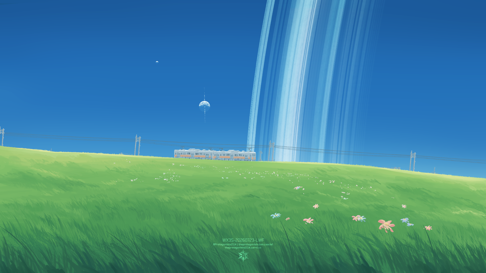 <b>57</b></a></td>
    <td align="center"><a href="./wall58.png"> <b>58</b></a></td>
    <td align="center"><a href="./wall59.png"> <b>59</b></a></td>
    <td align="center"><a href="./wall60.png"> <b>60</b></a></td>
  </tr>
  <tr>
    <td align="center"><a href="./wall61.png"> <b>61</b></a></td>
    <td align="center"><a href="./wall62.png"> <b>62</b></a></td>
    <td align="center"><a href="./wall63.png"> <b>63</b></a></td>
    <td align="center"><a href="./wall64.png"> <b>64</b></a></td>
  </tr>
  <tr>
    <td align="center"><a href="./wall65.png">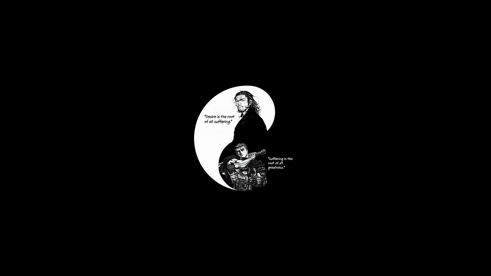 <b>65</b></a></td>
    <td align="center"><a href="./wall66.png"> <b>66</b></a></td>
    <td align="center"><a href="./wall67.png">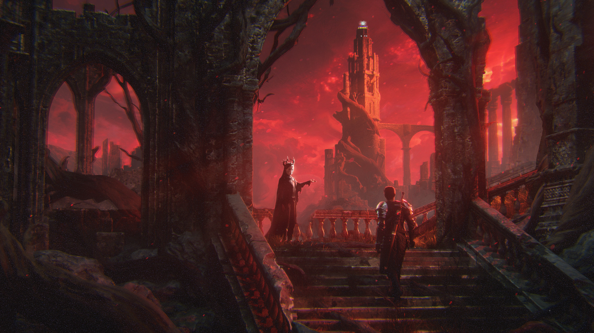 <b>67</b></a></td>
    <td align="center"><a href="./wall68.png"> <b>68</b></a></td>
  </tr>
  <tr>
    <td align="center"><a href="./wall69.png"> <b>69</b></a></td>
    <td align="center"><a href="./wall70.png"> <b>70</b></a></td>
    <td align="center"><a href="./wall71.png"> <b>71</b></a></td>
    <td align="center"><a href="./wall72.png"> <b>72</b></a></td>
  </tr>
  <tr>
    <td align="center"><a href="./wall73.png"> <b>73</b></a></td>
    <td align="center"><a href="./wall74.png"> <b>74</b></a></td>
    <td align="center"><a href="./wall75.png"> <b>75</b></a></td>
    <td align="center"><a href="./wall76.png"> <b>76</b></a></td>
  </tr>
  <tr>
    <td align="center"><a href="./wall77.png"> <b>77</b></a></td>
    <td align="center"><a href="./wall78.png"> <b>78</b></a></td>
    <td align="center"><a href="./wall79.png"> <b>79</b></a></td>
    <td align="center"><a href="./wall80.png"> <b>80</b></a></td>
  </tr>
  <tr>
    <td align="center"><a href="./wall81.png"> <b>81</b></a></td>
    <td align="center"><a href="./wall82.png"> <b>82</b></a></td>
    <td align="center"><a href="./wall83.png"> <b>83</b></a></td>
    <td align="center"><a href="./wall84.png"> <b>84</b></a></td>
  </tr>
  <tr>
    <td align="center"><a href="./wall85.png"> <b>85</b></a></td>
    <td align="center"><a href="./wall86.png"> <b>86</b></a></td>
    <td align="center"><a href="./wall87.png"> <b>87</b></a></td>
    <td align="center"><a href="./wall88.png">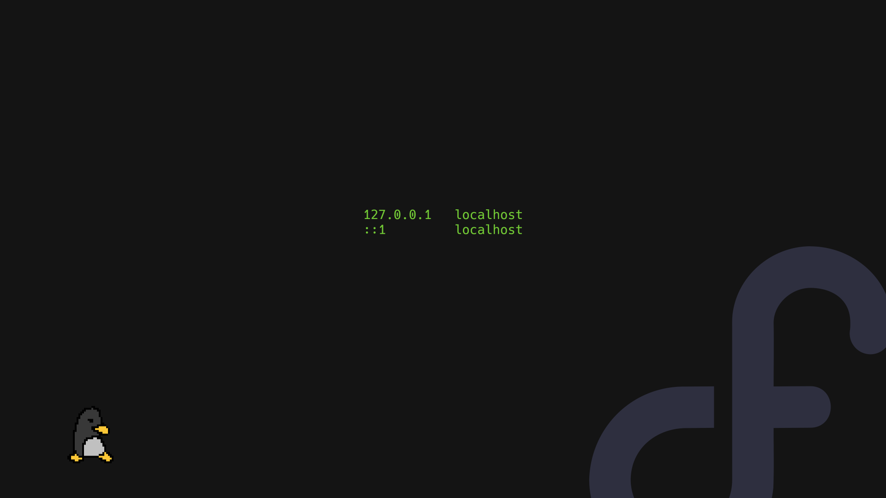 <b>88</b></a></td>
  </tr>
  <tr>
    <td align="center"><a href="./wall89.png"> <b>89</b></a></td>
    <td align="center"><a href="./wall90.png"> <b>90</b></a></td>
    <td align="center"><a href="./wall91.png"> <b>91</b></a></td>
    <td align="center"><a href="./wall92.png"> <b>92</b></a></td>
  </tr>
  <tr>
    <td align="center"><a href="./wall93.png"> <b>93</b></a></td>
    <td align="center"><a href="./wall94.png"> <b>94</b></a></td>
    <td align="center"><a href="./wall95.png"> <b>95</b></a></td>
    <td align="center"><a href="./wall96.png"> <b>96</b></a></td>
  </tr>
  <tr>
    <td align="center"><a href="./wall97.png"> <b>97</b></a></td>
    <td align="center"><a href="./wall98.jpg"> <b>98</b></a></td>
    <td align="center"><a href="./wall99.png"> <b>99</b></a></td>
    <td align="center"><a href="./wall100.png"> <b>100</b></a></td>
  </tr>
  <tr>
    <td align="center"><a href="./wall101.png"> <b>101</b></a></td>
    <td align="center"><a href="./wall102.png"> <b>102</b></a></td>
    <td align="center"><a href="./wall103.jpg"> <b>103</b></a></td>
    <td align="center"><a href="./wall104.jpg"> <b>104</b></a></td>
  </tr>
  <tr>
    <td align="center"><a href="./wall105.jpg"> <b>105</b></a></td>
    <td align="center"><a href="./wall106.jpeg"> <b>106</b></a></td>
    <td align="center"><a href="./wall107.jpg"> <b>107</b></a></td>
    <td align="center"><a href="./wall108.jpg"> <b>108</b></a></td>
  </tr>
  <tr>
    <td align="center"><a href="./wall109.png"> <b>109</b></a></td>
    <td align="center"><a href="./wall110.png"> <b>110</b></a></td>
    <td align="center"><a href="./wall111.png">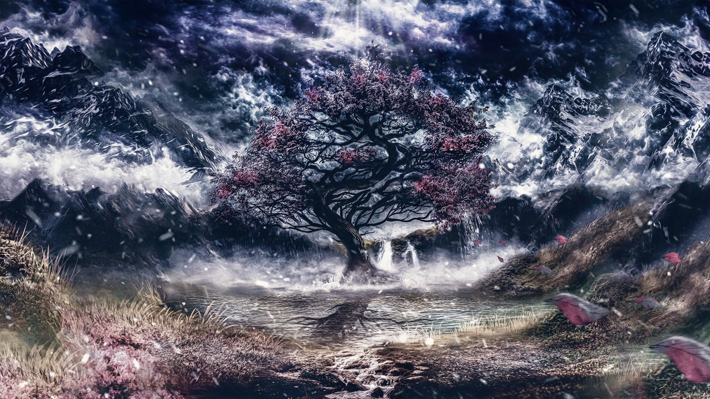 <b>111</b></a></td>
    <td align="center"><a href="./wall112.png"> <b>112</b></a></td>
  </tr>
  <tr>
    <td align="center"><a href="./wall113.png"> <b>113</b></a></td>
    <td align="center"><a href="./wall114.png"> <b>114</b></a></td>
    <td align="center"><a href="./wall115.png"> <b>115</b></a></td>
    <td align="center"><a href="./wall116.png"> <b>116</b></a></td>
  </tr>
  <tr>
    <td align="center"><a href="./wall117.png"> <b>117</b></a></td>
    <td align="center"><a href="./wall118.png"> <b>118</b></a></td>
    <td align="center"><a href="./wall119.png"> <b>119</b></a></td>
    <td align="center"><a href="./wall120.png"> <b>120</b></a></td>
  </tr>
  <tr>
    <td align="center"><a href="./wall121.png"> <b>121</b></a></td>
    <td align="center"><a href="./wall122.png"> <b>122</b></a></td>
    <td align="center"><a href="./wall123.png"> <b>123</b></a></td>
    <td align="center"><a href="./wall124.png"> <b>124</b></a></td>
  </tr>
  <tr>
    <td align="center"><a href="./wall125.png"> <b>125</b></a></td>
    <td align="center"><a href="./wall126.png"> <b>126</b></a></td>
    <td align="center"><a href="./wall127.png"> <b>127</b></a></td>
    <td align="center"><a href="./wall128.png"> <b>128</b></a></td>
  </tr>
  <tr>
    <td align="center"><a href="./wall129.png">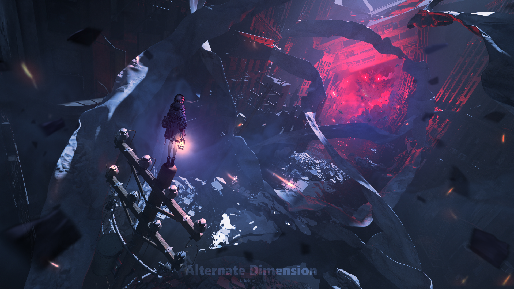 <b>129</b></a></td>
    <td align="center"><a href="./wall130.png"> <b>130</b></a></td>
    <td align="center"><a href="./wall131.png"> <b>131</b></a></td>
    <td align="center"><a href="./wall132.png"> <b>132</b></a></td>
  </tr>
  <tr>
    <td align="center"><a href="./wall133.png"> <b>133</b></a></td>
    <td align="center"><a href="./wall134.png"> <b>134</b></a></td>
    <td align="center"><a href="./wall135.png">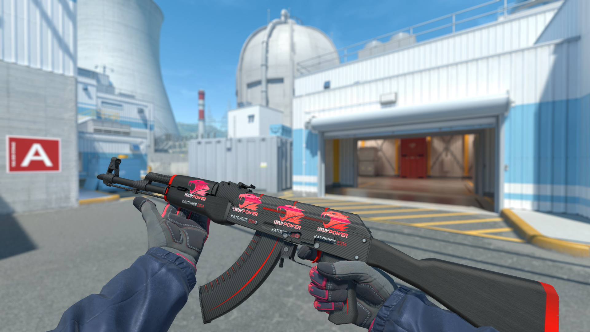 <b>135</b></a></td>
    <td align="center"><a href="./wall136.png"> <b>136</b></a></td>
  </tr>
  <tr>
    <td align="center"><a href="./wall137.png"> <b>137</b></a></td>
    <td align="center"><a href="./wall138.png"> <b>138</b></a></td>
    <td align="center"><a href="./wall139.png"> <b>139</b></a></td>
    <td align="center"><a href="./wall140.png"> <b>140</b></a></td>
  </tr>
  <tr>
    <td align="center"><a href="./wall141.png">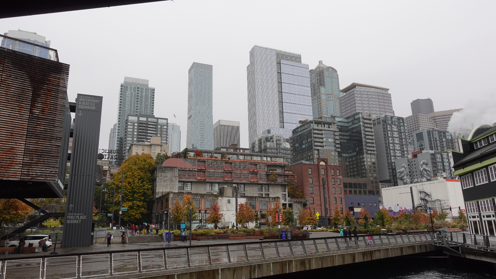 <b>141</b></a></td>
    <td align="center"><a href="./wall142.png">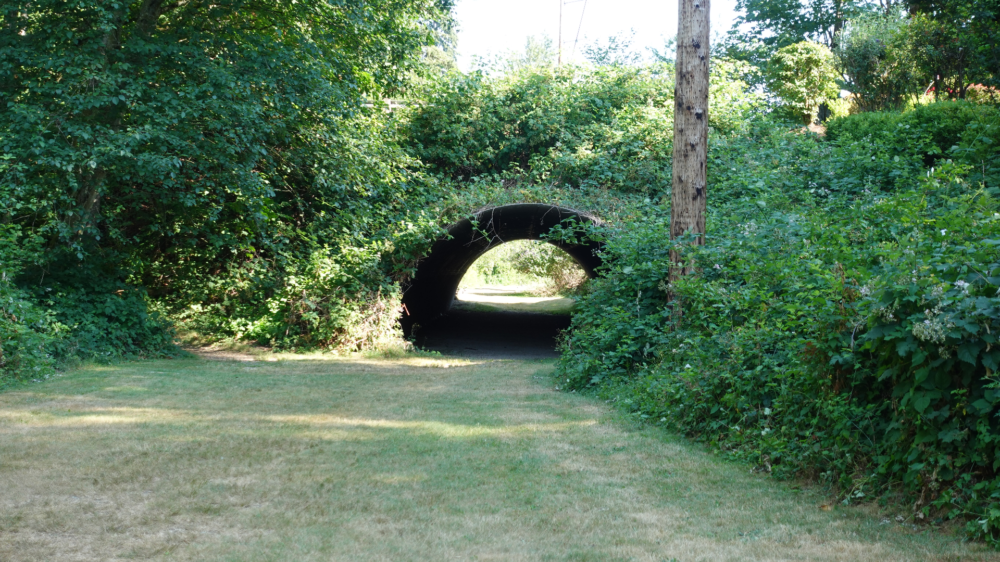 <b>142</b></a></td>
    <td align="center"><a href="./wall143.png"> <b>143</b></a></td>
    <td align="center"><a href="./wall144.png"> <b>144</b></a></td>
  </tr>
  <tr>
    <td align="center"><a href="./wall145.png"> <b>145</b></a></td>
    <td align="center"><a href="./wall146.png"> <b>146</b></a></td>
    <td align="center"><a href="./wall147.png"> <b>147</b></a></td>
    <td align="center"><a href="./wall148.png"> <b>148</b></a></td>
  </tr>
  <tr>
    <td align="center"><a href="./wall149.png"> <b>149</b></a></td>
    <td align="center"><a href="./wall150.png"> <b>150</b></a></td>
    <td align="center"><a href="./wall151.png"> <b>151</b></a></td>
    <td align="center"><a href="./wall152.png"> <b>152</b></a></td>
  </tr>
  <tr>
    <td align="center"><a href="./wall153.png"> <b>153</b></a></td>
    <td align="center"><a href="./wall154.png"> <b>154</b></a></td>
    <td align="center"><a href="./wall155.png"> <b>155</b></a></td>
    <td align="center"><a href="./wall156.png"> <b>156</b></a></td>
  </tr>
  <tr>
    <td align="center"><a href="./wall157.png"> <b>157</b></a></td>
    <td align="center"><a href="./wall158.png"> <b>158</b></a></td>
    <td align="center"><a href="./wall159.png"> <b>159</b></a></td>
    <td align="center"><a href="./wall160.png"> <b>160</b></a></td>
  </tr>
  <tr>
    <td align="center"><a href="./wall161.png"> <b>161</b></a></td>
    <td align="center"><a href="./wall162.png"> <b>162</b></a></td>
    <td align="center"><a href="./wall163.png"> <b>163</b></a></td>
    <td align="center"><a href="./wall164.png"> <b>164</b></a></td>
  </tr>
  <tr>
    <td align="center"><a href="./wall165.png"> <b>165</b></a></td>
    <td align="center"><a href="./wall166.png"> <b>166</b></a></td>
    <td align="center"><a href="./wall167.png"> <b>167</b></a></td>
    <td align="center"><a href="./wall168.png"> <b>168</b></a></td>
  </tr>
  <tr>
    <td align="center"><a href="./wall169.png"> <b>169</b></a></td>
    <td align="center"><a href="./wall170.png"> <b>170</b></a></td>
    <td align="center"><a href="./wall171.png"> <b>171</b></a></td>
    <td align="center"><a href="./wall172.png"> <b>172</b></a></td>
  </tr>
  <tr>
    <td align="center"><a href="./wall173.png"> <b>173</b></a></td>
    <td align="center"><a href="./wall174.png"> <b>174</b></a></td>
    <td align="center"><a href="./wall175.png"> <b>175</b></a></td>
    <td align="center"><a href="./wall176.png"> <b>176</b></a></td>
  </tr>
  <tr>
    <td align="center"><a href="./wall177.png"> <b>177</b></a></td>
    <td align="center"><a href="./wall178.png">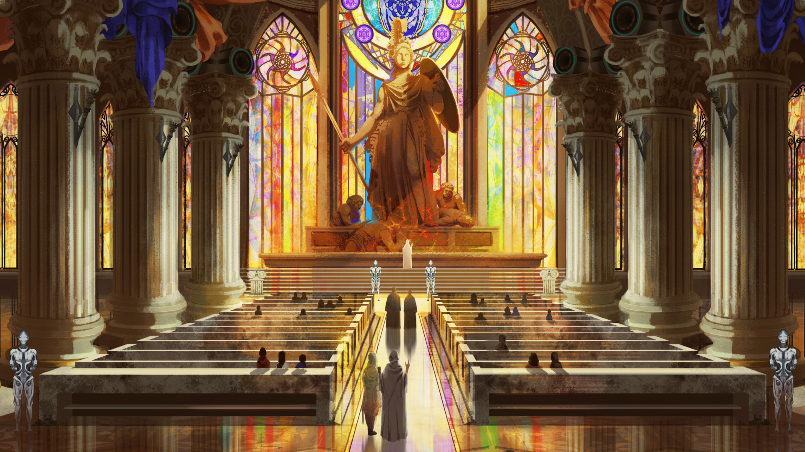 <b>178</b></a></td>
    <td align="center"><a href="./wall179.png"> <b>179</b></a></td>
    <td align="center"><a href="./wall180.png"> <b>180</b></a></td>
  </tr>
  <tr>
    <td align="center"><a href="./wall181.png"> <b>181</b></a></td>
    <td align="center"><a href="./wall182.png"> <b>182</b></a></td>
    <td align="center"><a href="./wall183.png">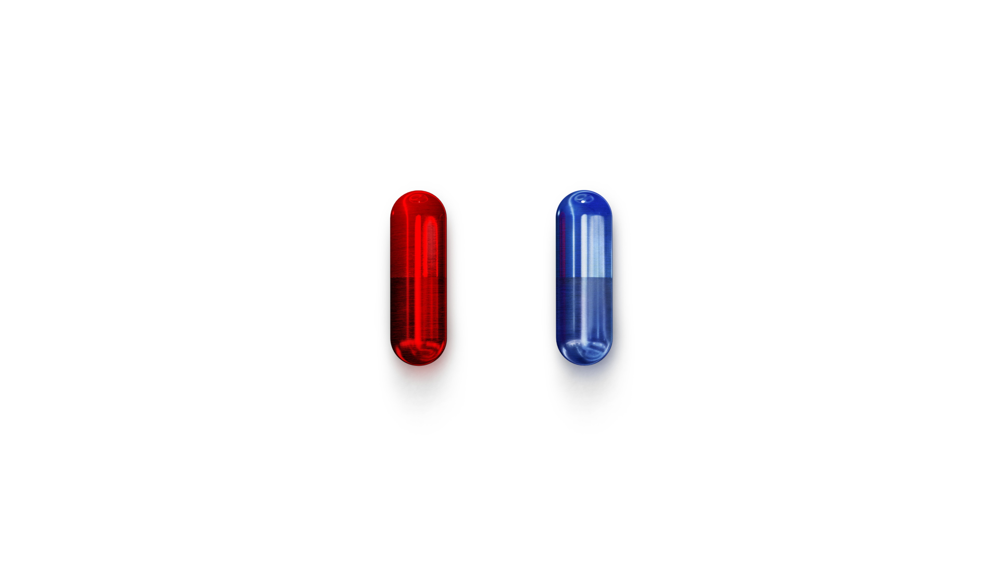 <b>183</b></a></td>
    <td align="center"><a href="./wall184.png"> <b>184</b></a></td>
  </tr>
  <tr>
    <td align="center"><a href="./wall185.png"> <b>185</b></a></td>
    <td align="center"><a href="./wall186.png"> <b>186</b></a></td>
    <td align="center"><a href="./wall187.png"> <b>187</b></a></td>
    <td align="center"><a href="./wall188.png"> <b>188</b></a></td>
  </tr>
  <tr>
    <td align="center"><a href="./wall189.png"> <b>189</b></a></td>
    <td align="center"><a href="./wall190.png"> <b>190</b></a></td>
    <td align="center"><a href="./wall191.png"> <b>191</b></a></td>
    <td align="center"><a href="./wall192.png">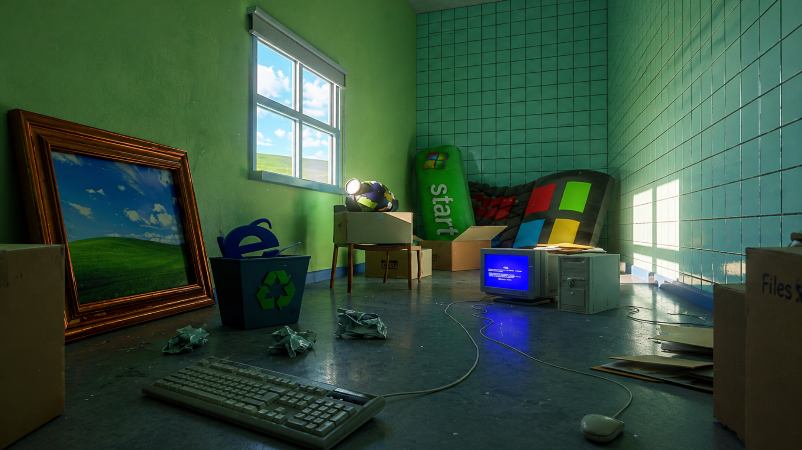 <b>192</b></a></td>
  </tr>
  <tr>
    <td align="center"><a href="./wall193.png">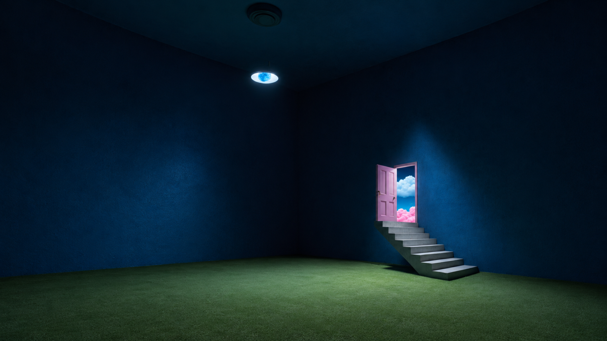 <b>193</b></a></td>
    <td align="center"><a href="./wall194.png"> <b>194</b></a></td>
    <td align="center"><a href="./wall195.png"> <b>195</b></a></td>
  </tr>
</table>
